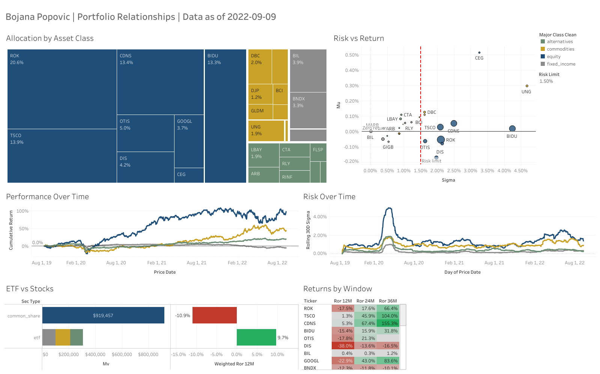

# Wealth Management Portfolio Analysis (SQL + Tableau)

Solo project for a data analytics course at Hult International Business School. I acted as a wealth manager for Client #128 (two accounts, 27 securities, $1.23M, data as of September 9, 2022): I extracted and transformed the data in MySQL, built an interactive Tableau dashboard, and wrote recommendations for management.

**Interactive dashboard:** [Tableau Public](https://public.tableau.com/views/A1Part2LoadingintoDataViz-MichelWard/BojanaPopovicPortfolioDashboard)

## Key results

| Question | Result |
|---|---|
| Portfolio return (market value weighted) | 12 months: −5.9% · 24 months: +30.8% · 36 months: +68.1% |
| Concentration | Stocks are about 75% of the portfolio; 4 stocks hold 61% of the money and created about 90% of the 36 month gain |
| Portfolio risk | Daily sigma of 1.40% |
| Rebalancing simulation | Moving 10% ($122,578) from the largest stock (ROK) into a short term TIPS fund (VTIP) cut daily sigma to 1.25% (about 10.5% less risk) and raised the average daily return |
| Best risk adjusted holding | LBAY, a long/short alternative fund (mu/sigma of 0.091 over a full year) |
| Weakest holdings | DIS lost in every window; long duration bonds (BNDX, GIGB) fell as rates rose in 2022 |

## Method

**SQL (MySQL)**
* Client view joining 5 tables: customers, accounts, holdings, security master list and daily prices
* Returns over 12, 24 and 36 months with self joins and DATE_SUB, weighted by market value, with a coverage check for securities without full history
* Daily returns, average daily return (mu) and risk (sigma) with the LAG window function
* Risk adjusted return (mu/sigma) to rank every holding
* Fixed income screening (handling inconsistent class labels with LIKE) and a before and after portfolio simulation using UNION ALL and CASE

**Tableau Public**
* Treemap of allocation, risk vs return scatter, cumulative performance and rolling 30 day risk over time, ETFs vs stocks, and returns by window
* Interactions: click to filter, hover to highlight, and a Risk Limit parameter that moves a threshold line

## Screenshots

*Full dashboard with the Risk Limit set to 1.5% daily sigma*

## Recommendations

1. Cut the largest stock from 20.6% to about 10% and move the proceeds into short term inflation protected bonds
2. Sell the holding that lost in every window and add to the best risk adjusted fund
3. Replace long duration bonds with short duration funds
4. Keep one gold ETF instead of three identical ones
5. Take profits gradually in the biggest winners and diversify into a broad market fund
6. Set a simple policy: no single stock above 10%, reviewed quarterly against the risk limit
7. Confirm the client's goals, time horizon and risk tolerance before any change

## Files

* [portfolio_analysis.sql](portfolio_analysis.sql): all queries, from the client view to the rebalancing simulation
* [Portfolio_Analysis_SQL_Report.pdf](Portfolio_Analysis_SQL_Report.pdf): Part 1, SQL extraction, results and business insights
* [Portfolio_Dashboard_Report.pdf](Portfolio_Dashboard_Report.pdf): Part 2, Tableau dashboard and report for management

## What I learned

Holding 27 securities does not make a portfolio diversified. This client's results depended on four stocks, and the "safe" bond layer failed because it protected against the wrong risk. Transforming prices into returns, risk and weights before loading them into Tableau is what turned raw data into insights a client can act on.
